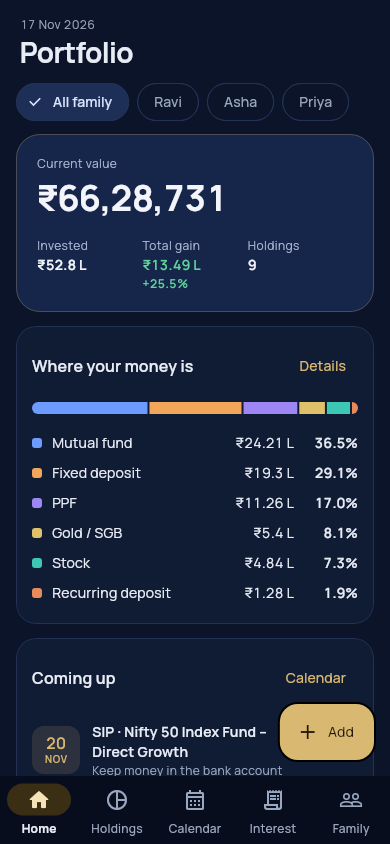
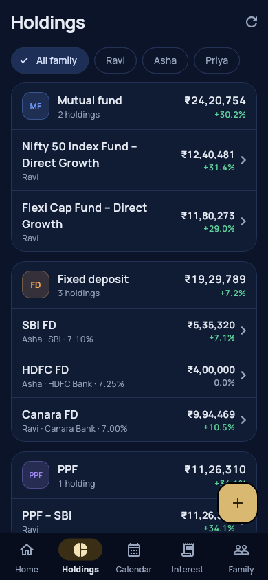
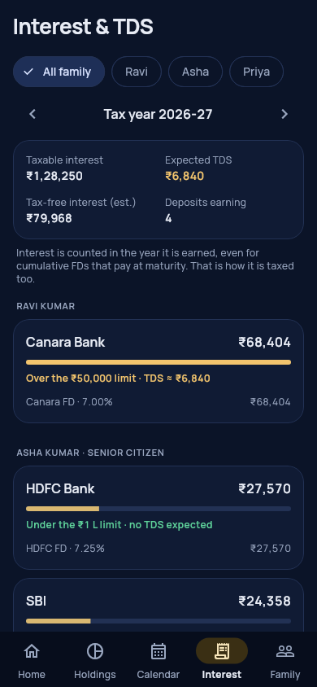
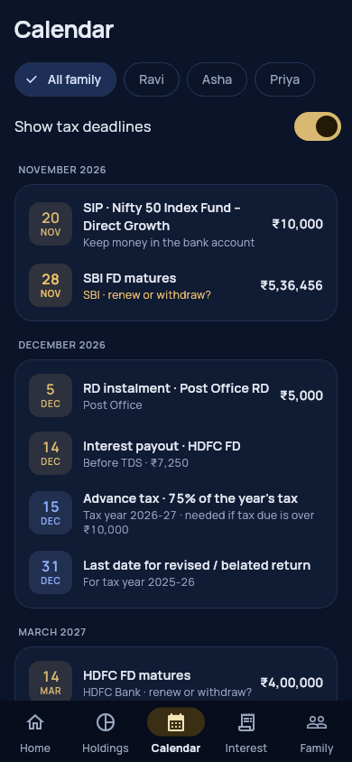

# Invest Tracker

A family investment tracker for India, built with Flutter and Firebase. It replaces the Excel sheet:
mutual funds, FDs, RDs, PPF, EPF, NPS, stocks, gold, post office schemes and more, for everyone in
the family, in one app.

<p>
  
  
  
  
</p>

## What it does (Phase 1)

- **Google login.** Data is stored in Firestore under your account and works offline too.
- **Family profiles.** Add parents, siblings and others. They don't need the app. You manage
  everything, and each investment belongs to one person.
- **All asset types.**
  - FDs, RDs, bonds and post office schemes: rate-based interest maths.
  - Mutual funds, stocks and gold: units × price.
  - PPF, EPF, NPS, property and insurance: a balance you update yourself.
- **Interest tracking.** For each deposit: interest earned so far, interest in each tax year, the
  maturity amount and the next payout.
- **TDS estimate.** Interest is grouped by bank and by person. The app shows when a bank will cross
  the TDS limit (₹50,000, or ₹1 lakh for senior citizens) and how much TDS to expect. It also tracks
  whether Form 15G/15H has been submitted.
- **Calendar.** Maturities, RD instalments, SIP dates, interest payouts and tax deadlines
  (advance tax, ITR, 31 March).
- **Free mutual fund prices.** Tap refresh on Holdings to pull today's NAVs from AMFI's public file.
  There's no server and no cost. Stock prices are updated by hand.
- **Themes.** Dark navy theme by default, plus light and auto modes.

Tax numbers live in [`lib/core/tax_rules.dart`](lib/core/tax_rules.dart), so they're easy to
update after a Budget.

## Roadmap

- **Phase 2:**
  - Import AIS (JSON) and match the TDS banks actually reported.
  - Import the mutual fund CAS PDF.
  - Import from Excel/CSV.
- **Phase 3:**
  - Capital gains (short-term vs long-term, the ₹1.25 lakh exemption).
  - XIRR from transactions.
  - Advance tax planner.
  - Reports for filing the ITR.
- **Phase 4:** reminders as phone notifications, and an iPhone build.

## Run it

You need [Flutter](https://docs.flutter.dev/get-started/install) (3.50 or newer) and Android
Studio, or a phone with USB debugging turned on.

```bash
flutter pub get
flutter test
```

The app won't start until Firebase is connected, as described below.

## Connect Firebase (one time, about 15 minutes)

1. **Create the project.** Go to <https://console.firebase.google.com> and click **Add project**.
   Google Analytics isn't needed.
2. **Turn on Google login.** Go to **Build → Authentication → Get started → Sign-in method** and
   enable **Google**.
3. **Create the database.** Go to **Build → Firestore Database → Create database**, pick a location
   in India (`asia-south1`, Mumbai) and choose **production mode**.
4. **Add the security rules.** Open the **Rules** tab, paste in the contents of
   [`firestore.rules`](firestore.rules), and click **Publish**. These rules mean each account can
   only see its own data.
5. **Link the app to Firebase.** Run these from this folder. They create `lib/firebase_options.dart`
   and `android/app/google-services.json`, and add the Google Services Gradle plugin:

   ```bash
   npm install -g firebase-tools
   firebase login
   dart pub global activate flutterfire_cli
   flutterfire configure --platforms=android,ios
   ```

6. **Allow Google login from your computer's build.** Get the signing fingerprints:

   ```bash
   cd android && ./gradlew signingReport
   ```

   Copy the `SHA1` and `SHA-256` of the `debug` variant. In Firebase, open **Project settings →
   Your apps → Android app → Add fingerprint** and add both. Then run `flutterfire configure` again
   so the updated `google-services.json` is downloaded.
7. **Start the app** with your phone connected:

   ```bash
   flutter run
   ```

If Google login fails with `DEVELOPER_ERROR` or code 10, the SHA-1 from step 6 is missing or
wrong. If it still fails, copy the **Web client ID** from Authentication → Sign-in method → Google →
Web SDK configuration into `kGoogleServerClientId` in
[`lib/data/auth_service.dart`](lib/data/auth_service.dart).

## Code layout

```
lib/
  core/       money formatting (₹12,34,567), tax years, tax rules
  models/     Member, Investment
  logic/      deposit interest maths, valuation, interest & TDS report,
              calendar events, AMFI NAV parsing  (pure Dart, unit tested)
  data/       Firestore repository, Google sign-in, Riverpod providers
  theme/      dark navy + gold theme, light theme
  ui/         screens
test/         unit tests for the maths, widget tests for the screens
```

Data is stored in Firestore like this:

```
users/{uid}/members/{memberId}          name, relation, email, PAN, date of birth
users/{uid}/investments/{investmentId}  one document per FD / fund / account
```

## Notes

- Interest figures are estimates from the rate (days ÷ 365). They're usually within a few rupees of
  the bank's figures, but banks round and post interest on their own schedules.
- Nothing here is tax advice. Check the numbers with your bank or a CA before filing.
